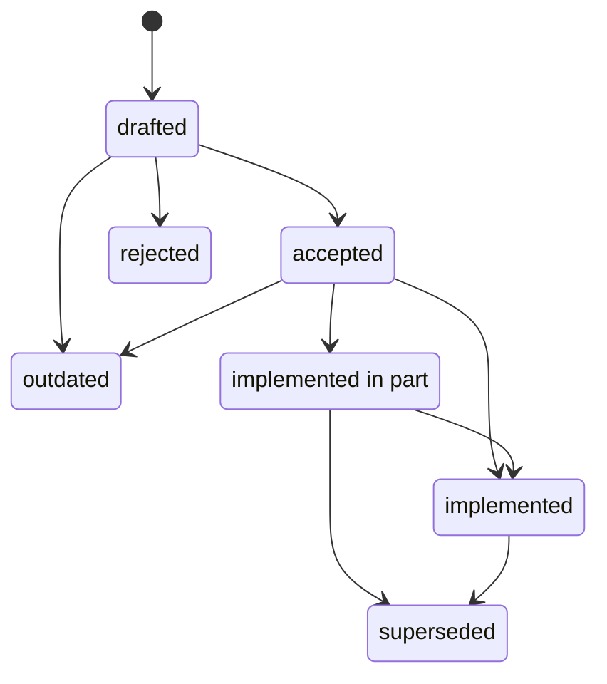

# Proposals

This is the index for numbered technical specifications and substantial
decisions. Proposals work like lightweight ADRs or RFCs.

Reserve a number in this index before creating its folder. Use a stable ID such
as `HQL-0001`, with the proposal itself at `HQL-0001/README.md`.

## Status

A proposal's `**Status**` line holds exactly one of these values and nothing
else:

| Status | Meaning |
| --- | --- |
| `drafted` | written, not yet decided |
| `rejected` | decided against |
| `accepted` | decided for, nothing of it built |
| `implemented in part` | accepted, and some of it built |
| `implemented` | accepted, and all of it built |
| `superseded` | implemented, at least in part, and then replaced by another proposal |
| `outdated` | replaced by another proposal before any of it was built |

A proposal with anything of it built is never `drafted` or `accepted`.
Building any part of a proposal accepts it and moves it to
`implemented in part`, in the same change that lands the code.

`superseded` and `outdated` differ only in whether anything was built: a
replaced proposal that was implemented, even in part, is `superseded`; one that
never was is `outdated`.

Details go in their own header fields, never on the status line:

- `**Superseded by**:` names the replacing proposal of a `superseded` or
  `outdated` one.
- `**Superseded in part by**:` names a proposal that replaces some rules of
  one that keeps its status.
- `**Extended by**:` names proposals that build on one without replacing it.
- `**Issues**:` names the issues that carried the implementation.

[ADR status](../status/ADR-status.hmd) reads every status line and flags a value
outside this list.

## Index

| ID | Status | Title |
| --- | --- | --- |
| [HQL-0001](HQL-0001/README.md) | implemented | The extension mechanism |
| [HQL-0002](HQL-0002/README.md) | implemented | Semantic retrieval over a precomputed embedding index |
| [HQL-0003](HQL-0003/README.md) | drafted | A graph example corpus |
| [HQL-0004](HQL-0004/README.md) | implemented | MapReduce: pipeline steps, stages and execution backends |
| [HQL-0005](HQL-0005/README.md) | implemented | Pipeline vocabulary and the logical/physical separation |
| [HQL-0006](HQL-0006/README.md) | implemented | `Stream<T>` as a first-class pipeline type |
| [HQL-0007](HQL-0007/README.md) | implemented | `collect` and `emit` are stream-shape operations |
| [HQL-0008](HQL-0008/README.md) | superseded | Presentation is separate from computation |
| [HQL-0009](HQL-0009/README.md) | implemented | Cells: identity, shared values and saved outputs |
| [HQL-0010](HQL-0010/README.md) | implemented | `tee` branches a pipeline without ending it |
| [HQL-0011](HQL-0011/README.md) | implemented | Names, their providers, and the naming lint |
| [HQL-0012](HQL-0012/README.md) | implemented in part | Data sources, targets and endpoints |
| [HQL-0013](HQL-0013/README.md) | implemented in part | Joins over named sides |
| [HQL-0014](HQL-0014/README.md) | implemented | `reduce` as the aggregation primitive, and `merge` as a combiner |
| [HQL-0015](HQL-0015/README.md) | implemented | `:=` is function alias syntax sugar |
| [HQL-0016](HQL-0016/README.md) | implemented | Type tests, narrowing, widening and conversion |
| [HQL-0017](HQL-0017/README.md) | implemented in part | Presentation formats |
| [HQL-0018](HQL-0018/README.md) | implemented | A type's constructor is an operation |
| [HQL-0019](HQL-0019/README.md) | implemented in part | Graph construction |
| [HQL-0020](HQL-0020/README.md) | implemented in part | The vault and its namespace |
| [HQL-0021](HQL-0021/README.md) | implemented | I/O: endpoints, channels, the network and logging |
| HQL-0022 | reserved | The AI harness extension |
| [HQL-0023](HQL-0023/README.md) | implemented | A document reference is written `@[[..]]` |
| [HQL-0024](HQL-0024/README.md) | implemented in part | A complete type system and the language model around it: traits, modules, receivers, the standard library and extensions |
| [HQL-0025](HQL-0025/README.md) | implemented in part | Execution contexts and running modes |
| [HQL-0026](HQL-0026/README.md) | implemented | Positions and slices: `xs[i]`, `xs[a:b]` and the `Slice` capability |
| [HQL-0027](HQL-0027/README.md) | implemented | Generic traits: type parameters on `trait` and `impl` |
| [HQL-0028](HQL-0028/README.md) | implemented | Import units, the program module and declaration visibility |
| [HQL-0029](HQL-0029/README.md) | implemented | Braces: `{}` is the empty set, `{:}` the empty Data |
| [HQL-0030](HQL-0030/README.md) | superseded | Supplementary ADR: Structural Types, Open Data Views, Type Contracts, and Data Contracts |
| [HQL-0031](HQL-0031/README.md) | implemented | `Decimal`, an exact decimal number type |
| [HQL-0032](HQL-0032/README.md) | implemented in part | Data Validation with `TypeContract` and `DataContract` |
| [HQL-0033](HQL-0033/README.md) | implemented | Errors as values — handling, routing, branching, retry and replay |
| [HQL-0034](HQL-0034/README.md) | implemented | Validator types |
| [HQL-0035](HQL-0035/README.md) | implemented in part | The schema boundary of a configured endpoint |
| [HQL-0036](HQL-0036/README.md) | implemented in part | Partitioning, shuffle boundaries and execution scheduling |
| [HQL-0037](HQL-0037/README.md) | implemented in part | Dataflow DAG, fan-out, fan-in, fork and merge |
| [HQL-0038](HQL-0038/README.md) | implemented | Functions |
| [HQL-0039](HQL-0039/README.md) | implemented | Traits, validator traits, a trait's type, and traits a module implements |
| [HQL-0040](HQL-0040/README.md) | implemented | `io.fs`: paths, folders, globs and entries |
| [HQL-0041](HQL-0041/README.md) | implemented | Time, statistics, digests and encodings, randomness, and the environment |
| [HQL-0042](HQL-0042/README.md) | implemented | Doc strings: HQL is the one source of a declaration's documentation |
| [HQL-0043](HQL-0043/README.md) | implemented | Public documentation: a reference page per primitive, permanent URLs and versions |
| [HQL-0044](HQL-0044/README.md) | implemented | Type checking is the semantic boundary; compilation is an execution strategy |
| [HQL-0045](HQL-0045/README.md) | implemented | The error model: failures as data, diagnostics as events, and the run-scoped diagnostic channel |
| [HQL-0046](HQL-0046/README.md) | implemented | Kafka topics and PostgreSQL tables as configured endpoints |
| [HQL-0047](HQL-0047/README.md) | implemented in part | Transports |
| [HQL-0048](HQL-0048/README.md) | implemented in part | I/O transport namespaces and packaging |
| [HQL-0049](HQL-0049/README.md) | implemented | NATS subjects and lakehouse tables as configured endpoints |
| [HQL-0050](HQL-0050/README.md) | implemented in part | Analytic windows, and a deterministic order for keyed selection |
| [HQL-0051](HQL-0051/README.md) | implemented in part | Transactions and relational mutations |
| [HQL-0052](HQL-0052/README.md) | drafted | Heterogeneous transaction coordination: `Atomic`, `Staged` and `Saga` scopes |
| [HQL-0053](HQL-0053/README.md) | implemented | Bytes, keys, signatures and encryption |
| [HQL-0054](HQL-0054/README.md) | accepted | Key vaults: stored keys, SSH agents, keychains and cloud key managers |
| [HQL-0055](HQL-0055/README.md) | implemented in part | Steps, autes, stages, tasks and jobs: units of computation and units of execution |
| [HQL-0056](HQL-0056/README.md) | drafted | Computation plans and backend engines |
