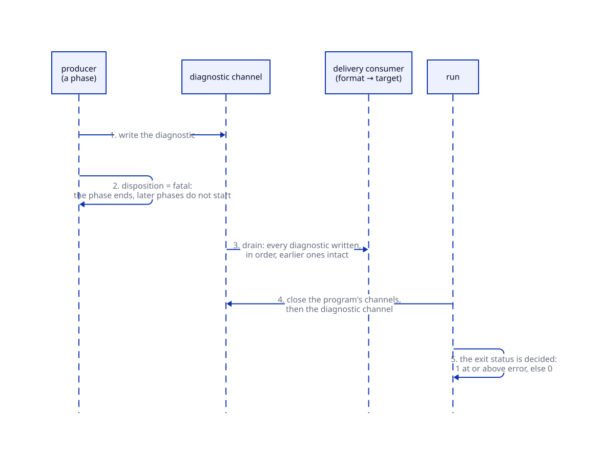

# Diagnostics

A diagnostic is a structured event a phase of the run writes when it cannot
do what the program asked, or has a fact about the program worth stating. It
is not a value of the program.

## The four axes

Every diagnostic has four independent fields, each set by the phase that
wrote it:

| Axis | Values | Says |
| --- | --- | --- |
| `phase` | `load`, `parse`, `check`, `plan`, `execute`, `render` | when it occurred |
| `kind` | `unexpected-token`, `unknown-name`, `type-mismatch`, `division-by-zero`, … | what the problem is |
| `severity` | `debug`, `info`, `warning`, `error`, `failure` | how serious it is |
| `disposition` | `warning`, `recoverable`, `fatal` | what the phase did next |

The text form is headed by three of them, `phase severity[kind]`. A parse
failure leaves no syntax tree:

```hql
[1, 2
```

```text
parse failure[unexpected-token]: expected `]` after collection elements, found end of input
 --> <expression>:1:6
  |
1 | [1, 2
  |      ^
```

A check error is found before anything runs:

```hql
"total: " + 3
```

```text
check error[type-mismatch]: `Add` for String takes String, not Int
 --> <expression>:1:13
  |
1 | "total: " + 3
  |             ^
```

An execute failure depends on a value, so `hql check` accepts the program and
the run fails:

```hql
[6, 0, 3] | map(n => 6 / n)
```

```text
execute failure[division-by-zero]: division by zero
 --> <expression>:1:22
  |
1 | [6, 0, 3] | map(n => 6 / n)
  |                      ^^^^^
  = element: 0, position 2 of 3 in `map`
  = bindings: n = 0
```

No axis is derived from another. A contract read `x | T` and a division by
zero both fail in the execute phase; the first is an `error`, a wrong value
read, and the second a `failure`, an operation with no result. An integer
literal outside the `Int` range is a `numeric-overflow` of the parse phase,
and the same kind in the execute phase is an addition whose sum left the
range.

## Fields beyond the axes

What a field carries is not repeated in the message. Under the caret, the
text form shows one `=` line per field that applies:

- `cell`: the cell of a document the diagnostic is about;
- `note`: a second place in the source, with what is there;
- `help`: what to write instead, a nearest name or a conventional spelling;
- `expected` and `found`: the type a step needed, and what was there;
- `element`: the element a step was applying its function to;
- `source`: the document a card the failure was about was read from;
- `bindings`: the parameters in scope where it failed;
- `trace`: the functions it was reached through, outermost first.

```hql
[1, 2] | mapp(n => n)
```

```text
check error[unknown-step]: `mapp` is not a pipeline step
 --> <expression>:1:10
  |
1 | [1, 2] | mapp(n => n)
  |          ^^^^^^^^^^^^
  = help: did you mean `map`?
```

<!-- run: novault -->
```hql
trait Shape { fn area(self) : Float }
type Circle { radius : Float }
impl Shape for Circle { fn area(self) : Float = 3.0f }
impl Shape for Circle { fn area(self) : Float = 4.0f }
1
```

```text
check error[duplicate-implementation]: `Shape` is already implemented for Circle: a trait has one implementation per type
 --> <expression>:4:1
  |
4 | impl Shape for Circle { fn area(self) : Float = 4.0f }
  | ^^^^^^^^^^^^^^^^^^^^^^^^^^^^^^^^^^^^^^^^^^^^^^^^^^^^^^
  = note: the first implementation, at <expression>:3:1
```

A failure inside called functions names each call that reached it, and the
parameters of the function it is in:

```hql
fn ratio(total: Int, parts: Int) : Int = total / parts

fn share(xs: List<Int>) : Int = ratio(xs | sum, size(xs) - 3)

share([4, 5, 6])
```

```text
execute failure[division-by-zero]: division by zero
 --> <expression>:1:42
  |
1 | fn ratio(total: Int, parts: Int) : Int = total / parts
  |                                          ^^^^^^^^^^^^^
  = bindings: parts = 0, total = 15
  = trace: share (call) → ratio (call)
```

A failure over a card's value names the document the card was read from.
Here the divisor is zero for the book of 112 pages:

```hql
cards
| filter(c => c.metadata.category == "book")
| map(c => match c.metadata.pages { some(Int n) => 1000 / (n - 112), _ => 0 })
```

```text
execute failure[division-by-zero]: division by zero
 --> <expression>:3:52
  |
3 | | map(c => match c.metadata.pages { some(Int n) => 1000 / (n - 112), _ => 0 })
  |                                                    ^^^^^^^^^^^^^^^
  = element: "a-room-of-ones-own", position 1 of 7 in `map`
  = source: examples/tutorial/books/a-room-of-ones-own.hmd
```

## The diagnostic channel

A run owns one diagnostic channel, `Channel<Diagnostic>`. It is a channel as
[chapter 15](../15-channels-and-logs.md) describes one: typed, in memory, its
values in the order they were committed. Two properties set it apart. Its
scope is the run, not one evaluation: it is opened before the loader reads
the vault and closed after the last phase, so a parse failure or a type error,
written before any HQL is evaluated, has a channel to go to. And the program
holds no name for it: no operation reads the channel of the run it is in.

Every phase writes into it in order. A check warning and an execute failure of
one run arrive in that order, and the failure leaves the warning intact:

```hql
fn totalOf(xs : List<Int>) : Int = xs | sum

totalOf([1, 2, 3]) / 0
```

```text
check warning[naming-convention]: `totalOf` is a function, written in snake_case
 --> <expression>:1:1
  |
1 | fn totalOf(xs : List<Int>) : Int = xs | sum
  | ^^^^^^^^^^^^^^^^^^^^^^^^^^^^^^^^^^^^^^^^^^^
  = help: write it `total_of`

execute failure[division-by-zero]: division by zero
 --> <expression>:3:1
  |
3 | totalOf([1, 2, 3]) / 0
  | ^^^^^^^^^^^^^^^^^^^^^^

2 diagnostics: 1 failure, 0 error, 1 warning
```

The loader writes into the same channel. A document whose header does not
parse is skipped with a `load warning[skipped-document]`, and the rest of the
vault is read. A warning never changes the exit status.

## Formats and targets

What the channel holds reaches a person or a tool through a format and a
target. The default is `DiagnosticText` on standard error, with the value on
standard output. The host's options change that wiring, not the program:

| Option | Effect |
| --- | --- |
| `--diagnostics-format json` | each diagnostic is one JSON document per line on standard error, every field that applies present |
| `--envelope json` | one JSON document on standard output: the type, the value, and the channel's contents under `diagnostics` |
| `--report-level LEVEL` | the lowest severity shown; a hidden diagnostic is still in the channel and in the envelope |

<!-- run: --diagnostics-format json -->
```hql
"total: " + 3
```

```text
{"disposition":"fatal","kind":"type-mismatch","message":"`Add` for String takes String, not Int","origin":"<expression>","phase":"check","severity":"error","span":{"end":13,"start":12}}
```

A **report** is the channel's contents rendered in a format, followed by a
count per severity when there is more than one. It names a presentation, not
an object of the run.

## Diagnostics as data in a later run

A run never reads its own channel, and a later run reads what an earlier one
delivered as it reads any data. `Diagnostic` is a record of the standard
library, so a file written with `--diagnostics-format json` reads back with
`| Diagnostic`, and `DiagnosticText` writes such records as the report a run
prints, without the source line:

<!-- run: skip -->
```hql
source(file("run.jsonl"), JsonLines)
| Diagnostic
| filter(d => d.severity == "error" or d.severity == "failure")
| format(DiagnosticText)
```

```text
execute failure[division-by-zero]: division by zero
 --> examples/error-handling/diagnostics/warning-then-failure.hql
```

## Continuation: `strict` and `collect`

Whether a phase continues after a diagnostic is the phase's. `--report
collect` asks every phase for as much continuation as it can give; `strict`,
the default, declines optional continuation after the first `error`.

| Phase | After an `error` | Under `collect` |
| --- | --- | --- |
| `load` | skips the document and continues | the same |
| `parse` | stops: nothing after an unparseable source has a structure | the same |
| `check` | stops at the first | checks every statement; a failed one still binds its name |
| `plan` | stops: a refused pipeline has no plan | the same |
| `execute` | stops at the first | `map` steps past an element whose function failed; an overflow or an I/O failure stops under both |
| `render` | stops at the failing cell | renders every cell, each reported against its own fault |

Under `collect`, the element `map` stepped past is lost, the value stands
without it, and the diagnostic says `disposition: recoverable`:

```text
$ hql --report collect '[6, 0, 3] | map(n => 6 / n)'
[1, 2]
execute failure[division-by-zero]: division by zero
 --> <expression>:1:22
  |
1 | [6, 0, 3] | map(n => 6 / n)
  |                      ^^^^^
  = element: 0, position 2 of 3 in `map`
  = bindings: n = 0
```

The value is on standard output and the diagnostic on standard error. In
`--diagnostics-format json` the same diagnostic carries
`"disposition": "recoverable"`; under `strict` it is `fatal` and there is no
value.

The exit status is `1` when the channel holds a diagnostic at or above
`error`, and `0` otherwise. The run above produced a value and still exits
`1`: a `failure` was written.

## The lifecycle of a fatal diagnostic

A fatal diagnostic ends its phase, and later phases do not start. What was
written before it stays in the channel, and the run ends only after the
channel's delivery consumers have delivered everything written:



Delivering a diagnostic never resumes the computation. Handling a failure is
done with data, on the [other side](handling.md) of the model.

## What is next

This is the last chapter. The [examples](../../examples.md) page lists the
runnable programs in the repository, the error-handling cases among them.
