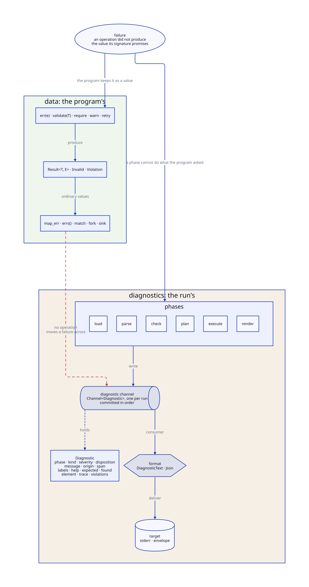

# 18. Errors

A **failure** is an operation that did not produce the value its signature
promises. HQL has two kinds of failure, and each has its own mechanism:

- A **data failure** is a value. `err(e)` of a `Result<T, E>`, and an
  `Invalid` with its `Violation`s, are ordinary values of the program: `map`,
  `match`, `errs()` and `sink` act on them as on any other value.
- A **diagnostic** is an event. A phase of the run — the loader, the parser,
  the checker, the planner, the evaluator or the renderer — writes one when it
  cannot do what the program asked. The program never constructs a
  diagnostic and never reads one.

The call site determines which of the two a data failure is. `x |
validate(User)` gives `Result<User, Invalid>`, a value; `x | User` requires
`x` to read as a `User`, and a value that does not is a diagnostic of the
execute phase. No operation moves a failure from one side to the other.

| Term | Meaning |
| --- | --- |
| failure | an operation did not produce the value its signature promises |
| data failure | a failure the program keeps as a value: `err(e)`, `Invalid`, `Violation` |
| diagnostic | a structured event describing a failure, written by a phase |
| phase | when the diagnostic occurred: `load`, `parse`, `check`, `plan`, `execute`, `render` |
| kind | what the problem is, by a stable kebab-case name: `type-mismatch`, `division-by-zero` |
| severity | how serious it is: `debug`, `info`, `warning`, `error`, `failure` |
| disposition | what the phase did next: `warning`, `recoverable`, `fatal` |
| diagnostic channel | the one `Channel<Diagnostic>` of a run, which every phase writes into |
| format | a rendering of a diagnostic: `DiagnosticText`, `Json` |
| target | where a rendered diagnostic is delivered: standard error by default |

The two pages of this chapter take the sides in turn:

- [Failures as data](handling.md): `Result`, `validate`, `Invalid` and
  `Violation`, and the operations over them.
- [Diagnostics](diagnostics.md): the four axes, the diagnostic channel, the
  formats, `strict` and `collect`, and the exit status.
